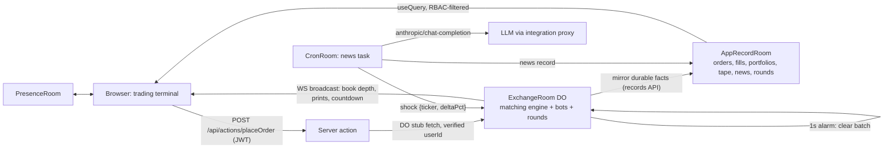

# Simulated HFT Exchange on DeepSpace: Plan

Status: **planning only**. Nothing is scaffolded or built yet. This file is the build contract; `PROMPTS.md` logs every prompt that shaped it.

## 1. What we're building

A multiplayer stock exchange simulator. Players sign in, get $100,000 in fake cash, and trade three fictional stocks against a live order book. Everyone sees the same market in real time: order book depth, trades, positions, and the leaderboard. AI-written fake news headlines move each stock's hidden "true value", and bots trade toward it, so the price follows. Orders that arrive at the same moment are handled fairly by a **frequent batch auction**: every order in a 1-second window counts as simultaneous, so a faster connection gives no edge.

The core loop: read the news → place or cancel orders → the batch clears → your fills, positions, and rank update for everyone → the round ends → the winner is recorded → a new round starts.

## 2. Locked decisions

| # | Decision | Choice | Why |
|---|----------|--------|-----|
| D1 | Same-instant fairness | **Frequent batch auction** (1s batches, one clearing price per batch, pro-rata ties with a public, checkable tiebreak) | Speed within a batch gives no advantage. It also means HTTP latency on order entry doesn't matter, so order entry can be a plain server action. |
| D2 | Instruments | **3 fictional tickers in different sectors** | News can target one sector, so players have to choose which stock to trade. |
| D3 | Time model | **Timed rounds with reset** (15 min round + 2 min results break) | Late joiners and judges can still compete. Each round produces a clear winner. |
| D4 | Risk rules | **Long-only, no margin** | Cash is reserved for buys and shares for sells, so balances can never go negative. These are the simplest rules that are still correct. |
| D5 | Chat | **None** | Keeps the build focused on the exchange. Presence already gives the room a social feel. |
| D6 | Who decides a news event's price impact | **The engine**, using a seeded random draw. The LLM only writes the headline for a direction and size it is given. | Price logic stays deterministic and testable. A bad or prompt-injected LLM reply can't cause a large price swing. |
| D7 | Order privacy | Open orders and fills are **private** (`read: 'own'`). Book depth is shown only as totals per price level. Portfolios are **public**. | Real exchanges keep orders anonymous, and showing pending intent would invite front-running. Public portfolios satisfy "positions … for everyone" and let the leaderboard be computed with no extra writes. |

Defaults chosen and open to change: 1s batch, 15 min rounds, $100k start, tickers priced in integer cents, quantities in whole shares.

## 3. Architecture

### Why a custom Durable Object for matching

The matching engine has to be **atomic and serialized**, and it needs a **sub-second timer**. I checked the SDK (`deepspace@0.44.2`, `dist/worker.d.ts`) against those needs:

- `RecordRoom`'s write and broadcast paths are all `private` (`handleRecordMessage`, `createRecordContext`, ~L1279–1329). A subclass can't add atomic multi-record logic without depending on internals.
- Server actions call RecordRoom through `tools.*`, one DO request per call, so two concurrent `placeOrder` actions could interleave between awaits. That is not safe for matching.
- `CronRoom`'s minimum interval is 1 minute, which is too slow for 1s batches.
- `BaseRoom` is the SDK's documented base for custom rooms. It gives verified-JWT WebSocket identity, `sql` (SQLite), `broadcast`/`sendTo`, `onRequest`, and `onAlarm` (~L826–946). The docs say to subclass it "only when none of the specialized rooms fit". This is that case.

So `ExchangeRoom extends BaseRoom` is the single source of truth for money: accounts, holdings, reservations, the book, and batches. It clears each batch inside one `transactionSync`. `AppRecordRoom` holds a **one-way projection** of durable, per-user, or historical facts, so the app keeps the platform's RBAC, `useQuery` sync, and reconnect handling instead of rebuilding them. Market data that changes every tick (depth, last price, countdown) goes over ExchangeRoom's own WebSocket, which keeps record writes per tick low.

### Order intake path

1. The client calls `POST /api/actions/placeOrder` with `{ ticker, side, type, qty, limitCents }`. The DeepSpace server action verifies the JWT, and `ctx.userId` becomes the trader.
2. The action fetches the `ExchangeRoom` stub (singleton `exchange:<APP_ID>`) at an internal path. That path can't be reached from the public internet.
3. The DO validates and reserves synchronously (cash or shares, price band, per-batch order cap, self-cross check), assigns `orderId` and the current `batchId`, and returns the ack. Client timestamps are ignored.
4. The order waits until its batch clears. `cancelOrder` follows the same path and releases the reservation if the order hasn't filled.

### Batch clearing (every 1s while a round is live)

For each ticker, inside one `transactionSync`:

1. **Clearing price.** Take every limit price in the book as a candidate. For each price p, compute D(p) = total buy quantity with limit ≥ p and S(p) = total sell quantity with limit ≤ p. Pick the p that maximizes min(D, S). Break ties by the smallest |D − S|, then the price closest to the last price, then the lower price.
2. **Allocation.** Orders priced strictly better than p fill in full. On the side with more quantity at p, the orders sitting exactly at p are rationed:
   - **Earlier batches first** (resting orders keep time priority between batches).
   - **Within one batch, pro-rata** by remaining quantity, rounded to whole shares by largest remainder.
   - Leftover share ties go to the lowest `H(seed, orderId)`, where `seed = SHA-256(roundId | ticker | batchId | sorted orderIds)`. All inputs are server-generated, and the seed is published on the tape record, so anyone can recompute the allocation.
3. **Settlement.** Everyone trades at the uniform price p. Buyers get back reserved cash for any difference between their limit and p. Reservations are released for filled quantity.
4. **Bots re-quote** for the next batch (see §5).
5. After the transaction: broadcast depth and prints over WS, then mirror changed orders, fills, portfolios, and the tape to RecordRoom. Mirror writes use server-generated ids and are idempotent, so a retried alarm can't duplicate a fill.

Market orders are limit orders at the edge of the price band (±10% of last), which also works as a circuit breaker. The alarm only re-arms while a round is live, and it pauses when nobody has connected for a set time, so an idle app doesn't keep burning alarms.

## 4. Data model

### AppRecordRoom collections (scope `app:<APP_ID>`): engine-written, clients read-only

| Collection | Key fields | Read | Client writes |
|------------|------------|------|---------------|
| `users` (scaffold, extended) | displayName | scaffold default (`'own'` + `useUsers()` roster) | scaffold default |
| `tickers` | symbol, name, sector, lastCents, openCents | `true` (incl. `*`) | none |
| `orders` | userId (ownerField, userBound), ticker, side, qtyShares, limitCents, filledShares, status, batchId, roundId | `'own'` | none, only via action → engine |
| `fills` | userId (ownerField), orderId, ticker, side, qtyShares, priceCents, batchId, roundId | `'own'` | none |
| `tape` | ticker, batchId, roundId, clearCents, volumeShares, seed, at | `true` | none |
| `portfolios` | userId (ownerField), displayName, roundId, cashCents, holdings (json) | `true` | none |
| `news` | roundId, ticker, headline, body, publishedAt (impact size **not** stored) | `true` | none |
| `rounds` | roundId, startsAt, endsAt, status, standings (json), winnerId | `true` | none |

Every collection grants clients `create/update/delete: false`. The only writer is the app's server-side code (`X-App-Action`). The leaderboard is computed on the client as `portfolios × live prices`, so it needs no extra write path and updates every tick.

### ExchangeRoom SQLite (private, the authority)

`accounts(userId, roundId, cashCents, reservedCents)`, `holdings(userId, ticker, qty, reservedQty)`, `book(orderId, userId, ticker, side, qty, remaining, limitCents, batchId, status)`, `batches(batchId, ticker, seed, clearCents, volume)`, `fundamentals(ticker, valueCents, targetCents, rampLeft)`, `meta(roundId, phase, batchId, endsAt)`.

Invariant, checked in unit tests and after every batch: for each user, `cash + reserved ≥ 0` and `qty ≥ reservedQty ≥ 0`, and total cash plus total shares across all accounts stays constant within a batch (trades only move value between accounts).

## 5. Price dynamics and bots

- **Hidden fundamental value** per ticker: a small random walk each batch, plus news shocks spread over ~10–20 batches. The spread is deliberate: a player who reads the headline quickly can act before the price fully adjusts, and that is the skill in the game.
- **Market-maker bot**: quotes bid and ask around a lagged estimate of the fundamental, with limited size and inventory skew. It provides liquidity so even one player has someone to trade with.
- **Noise-trader bot**: occasional small marketable orders, so the tape keeps moving.
- Bots submit through the **same intake and the same rules**, with no speed edge (batches make that impossible). They are excluded from the leaderboard.
- All randomness comes from a per-round seeded PRNG, so tests and replays are deterministic.

## 6. Fake news pipeline

- A `CronRoom` task `news` runs with `intervalMinutes: 1` (the platform minimum). Each run fires with a set probability, so events land irregularly about every 1–3 minutes, and only during a live round.
- The engine-side code draws `{ticker, direction, size: minor 1–2% | major 4–8%}` from the round PRNG.
- The LLM call is `anthropic/chat-completion` (`claude-haiku-4-5`) through `ctx.integrations.call`, which bills the owner and keeps the key on the server. The prompt includes the fictional company and sector and asks for strict JSON `{headline ≤ 90 chars, body ≤ 2 sentences}` whose tone matches the given direction and size.
- The reply is validated: parsed JSON, length limits, and no real tickers or company names. On any failure the event is **skipped and logged**. No price shock happens without a published headline (fail closed).
- Order of operations: write the `news` record first, then send the shock to ExchangeRoom, which applies it starting **next batch**. Everyone gets the headline before any price effect.
- An owner-only server action, `breakingNews` (gated on `OWNER_USER_ID`), fires an event on demand for demos.
- Cost: at most ~60 small Haiku calls per hour, only while a round is live. No client can trigger a paid call.

## 7. Rounds

The engine owns the round lifecycle through its alarm. Rounds start on schedule (15 min live → 2 min results). A player is enrolled with $100k on their first action in the round.

At round end the engine:

1. cancels all open orders,
2. marks every account to the last clearing price,
3. writes final standings and the winner to `rounds`,
4. resets fundamentals and bots for the next round.

The UI shows the round countdown and the next-batch countdown, both from the ExchangeRoom stream.

## 8. Frontend

- `/` is a static landing page for signed-out visitors: the pitch, how the auction works, and sign in.
- `/(app)/(protected)/trade` is the terminal:
  - ticker tabs
  - live price chart (tape history plus the live stream)
  - depth ladder
  - order ticket (limit/market, buy/sell)
  - my open orders with cancel
  - my fills
  - positions and P&L
  - news feed
  - leaderboard
  - online traders
  - batch and round countdowns
- `/(app)/rounds` lists past rounds with winners and standings.
- A fairness "audit" drawer per tape print shows the seed, clearing curve, and allocation. It is a nice-to-have, built only if Day 5 has room.
- Design follows the DeepSpace design workflow (`/design/*`), not the scaffold placeholder theme.

## 9. DeepSpace integrations: used and left out

Used, with the reason each one is in the app:

| Integration / primitive | Role |
|-------------------------|------|
| Auth (Better Auth via SDK) | Every order is tied to a verified JWT identity. No identity ever comes from the client. |
| RecordRoom + RBAC schemas | Private orders and fills, public portfolios, tape, and news, with live `useQuery` sync and automatic reconnect and resync. |
| Server actions | JWT-verified order entry, cancel, and owner-only breaking news. |
| Custom Durable Object (`BaseRoom`) | Serialized matching, 1s alarm, money authority, and the live market-data socket. |
| CronRoom (scheduled jobs) | The news cadence. `useCronMonitor` powers the owner's trigger button. |
| AI integration (`anthropic/chat-completion` through the proxy) | Headline writing. Owner-billed, server-side only, no API key in the code. |
| Presence (`usePresence` + `usePresenceRoom`) | Shows who is online and which ticker each trader is watching. |
| `deepspace/testing` multi-user fixture | Two real users submitting in the same batch. |
| `npx deepspace deploy` | Ships the app to `<name>.app.space`. |

Left out on purpose:

- **Payments.** The money is fake by design. Real payments would add risk and no value.
- **finnhub / coinbase real quotes.** The market is fictional on purpose. Real prices would fight the news engine and cost money every call.
- **Image generation for news.** Too slow and too costly per headline for little gain.
- **TTS news anchor.** Fun, but not core to the game.
- **Chat.** See D5.
- **File uploads, Yjs, and Canvas.** Nothing in the product needs them.
- **Email.** There is nothing worth emailing in a 15-minute round.

## 10. Security rules

- Identity comes only from `ctx.userId` (verified JWT) or the WS JWT. No client-supplied userId is accepted anywhere.
- ExchangeRoom's order and shock endpoints are reachable only through the DO stub from the worker.
- Clients have no write access to any exchange collection.
- `breakingNews` is owner-gated. The `/ws/cron` role resolver is narrowed so that only admins can trigger cron tasks, because the default lets members fire owner-billed tasks.
- Per-user caps: at most N orders per batch and M open orders.
- No secrets are needed, because LLM calls go through the integration proxy. Nothing goes into `.dev.vars` by hand.

## 11. Verification plan

- **Unit tests (Vitest), for the money path.** The engine core is a pure module with no DO dependencies, so it can be tested directly:
  - clearing price selection, including ties
  - pro-rata and largest-remainder allocation
  - seed tiebreak reproducibility
  - reservations and refunds
  - band clamps
  - self-cross rejection
  - conservation and no-negative invariants under randomized order streams
- **`api.spec.ts`**:
  - `placeOrder` without auth → 401
  - invalid quantity or price → rejected
  - insufficient cash → rejected
  - cancel someone else's order → rejected
  - `breakingNews` as a non-owner → forbidden
- **`collab.spec.ts`** (two real users):
  - A and B submit crossing orders in the same batch. Both see the print, and both portfolios and the leaderboard update.
  - Two identical simultaneous buys against limited supply each get a pro-rata fill.
  - B cannot see A's open orders.
- **Integration boundary.** The `anthropic/chat-completion` response is mocked in tests (the documented carve-out). One real `integrations invoke` is run during the spike.
- **Live smoke on the deployed URL** with two fresh accounts, covering the core loop, a news event, and a round rollover, with screenshots as evidence.

## 12. Five-day schedule

The task breakdown for workers is in `orchestrations/files/README.md`.

| Day | Work | Exit check |
|-----|------|-----------|
| 1 | `auth whoami` → scaffold → **de-risk spike** (S1–S5 below) → pure engine module + unit tests | Spike results recorded; engine tests pass |
| 2 | ExchangeRoom wiring: intake actions, reservations, alarm loop, bots, rounds, RecordRoom mirror + schemas/RBAC | A single user trades against bots locally |
| 3 | Trading terminal UI, live stream, leaderboard, presence, rounds page | Two local users trade and see each other |
| 4 | News cron + LLM + validation, owner controls, api/collab specs, first deploy | Specs pass; deployed app runs the core loop |
| 5 | Live two-account smoke, design pass, fixes, writeup (README submission note) | Evidence captured; deliberately unfinished edges listed |

### De-risk spike (before building on these assumptions)

- **S1.** A custom `BaseRoom` subclass in `__DO_MANIFEST__` deploys and accepts a JWT-verified WS via the scaffold's `wsRoute` pattern.
- **S2.** A `setAlarm` 1s cadence holds steady, and it stops cleanly when idle.
- **S3.** The DO can write to RecordRoom (`buildCronContext(...).records`) from inside an alarm. Measure writes per tick and confirm they fit under the platform's subrequest limits. **Fallback if not:** keep per-tick data on the WS only and mirror to RecordRoom every few seconds.
- **S4.** `npx deepspace integrations info anthropic/chat-completion` and one paid `invoke` (a few cents), to confirm the request body and output shape.
- **S5.** At least two usable test accounts for the collab specs.

If S1 or S3 fails with no workaround, I stop and bring options back to you rather than quietly reducing the core feature.

## 13. Next steps beyond five days

- A player strategy API, so players can submit algorithmic bots. That is real HFT play, and batch auctions keep it fair.
- Shorting with margin and liquidation.
- IOC and stop orders.
- Persistent candle history and round replays.
- A recompute-it-yourself fairness audit page.

## 14. Submission note checklist (from `project-guidlines.md`)

- [ ] Live URL (`<name>.app.space`)
- [ ] Repository
- [ ] What was built
- [ ] DeepSpace integrations used and left out (§9)
- [ ] The main tradeoff: a custom serialized DO as the money authority, with RecordRoom as a read projection (vs. pure platform records), plus batch auction vs. continuous matching
- [ ] What the agent did, and what I verified or changed myself (see `PROMPTS.md`)

## Sources consulted

- docs.deep.space: `llms.txt`, `concepts/architecture`, `concepts/data-model`, `concepts/permissions`, `concepts/realtime-sync`, `guides/building-an-app`, `guides/server-actions`, `guides/scheduled-jobs`, `guides/external-apis`, `guides/presence-and-cursors`, `guides/testing`, `sdk-reference/worker/rooms`
- The deepspace-skill `SKILL.md`, and `deepspace@0.44.2` `dist/worker.d.ts`
- `npx deepspace integrations list`
