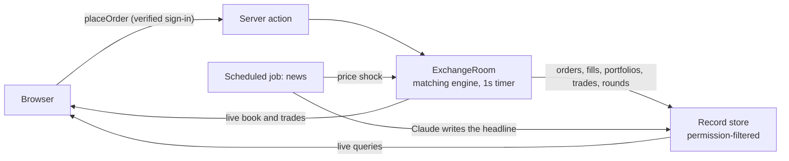

# tickfair

**A multiplayer stock exchange you can't win just by being faster.** Players trade three made-up stocks with fake money against a live order book. Trades, positions, and the leaderboard update for everyone in real time. AI-written fake news moves prices. Orders placed in the same second are treated as simultaneous.

Built on [DeepSpace](https://docs.deep.space) by directing a team of coding agents.

- **Prompts, decisions, and workflow:** [PROMPTS.md](PROMPTS.md). Every prompt I gave, word for word, and what happened next.
- Plan: [PLAN.md](PLAN.md) · Agent briefs: [orchestrations/files/](orchestrations/files/) · Build log: [PROGRESS.md](orchestrations/files/PROGRESS.md)

---

## Try it

**Live:** <https://tickfair.app.space>

1. Open the landing page. Read "How it works" if you want the 30-second version.
2. Click **Sign in to trade** and sign in with Google or GitHub.
3. On `/trade`, pick a stock (ORBT, CURA, or VOLT) and place a limit or market order. You start each round with $100,000.
4. Open a second browser as another user to see the multiplayer side. Both of you see the same book, the same trades, and each other's moves on the leaderboard.

**Run locally** (Node 24, npm 11, a DeepSpace account):

```bash
npm ci
npx deepspace dev start          # http://localhost:5173
npx deepspace test run all       # 286 unit + 36 browser tests
```

Local servers don't make paid AI calls, so news headlines are off unless you set `NEWS_LLM_IN_DEV=true`.

---

## How it works

### The fairness idea: frequent batch auctions

A normal exchange processes orders one by one, so whoever's packet arrives first wins. tickfair instead collects every order for **1 second**, then clears them together:

1. **One price per batch.** The engine picks the single price that trades the most shares. Ties are broken by the smallest imbalance, then by the price closest to the last price.
2. **Everyone trades at that price.** If you bid more than the clearing price, you pay the clearing price, and the reserved difference comes back to you.
3. **Ties are split fairly.** When there aren't enough shares to go around at the clearing price:
   - orders from earlier batches fill first;
   - orders within the same batch are split in proportion to their size;
   - any leftover single share goes to the lowest `sha256(seed + orderId)`.

   The seed is published on every trade.

So clicking 50 ms earlier gives no advantage, and the evaluator verified that with real browsers.

### Architecture



- **One room holds all the money.** `ExchangeRoom` is a custom Durable Object built on the SDK's `BaseRoom`. Each batch's clearing, settlement, and bot quotes run in one synchronous SQLite transaction with no awaits. After every batch it checks that no money or shares were created or destroyed and no balance went negative. If a check fails, the round halts.
- **The main tradeoff: a custom room instead of the built-in record store for the engine.** The SDK's built-in record room keeps its write path private, server actions can interleave with each other, and the scheduler can only run once a minute. A matching engine needs atomic, serialized writes and a 1-second timer. The cost is more code to own and review (hence the independent money review and the per-batch checks); the benefit is a fairness guarantee the platform's general-purpose primitives can't give.
- **Results are copied into DeepSpace's record store**, so the app gets the platform's permissions, live sync, and reconnect handling instead of rebuilding them. Your open orders and fills are visible only to you. Portfolios and trades are public, so the leaderboard is just portfolios × live prices.
- **Bots** (a market maker and a noise trader) keep the market moving even with one player. They go through the same order intake and rules as players and are left off the leaderboard.
- **News:** a scheduled job picks the stock, direction, and size of each price move. Claude only writes the headline. The headline is published before the price starts moving, and if the AI reply fails validation, there is no price move.
- **Rounds:** 15 minutes of trading, then a 2-minute results screen. Then everyone resets to $100,000.

### DeepSpace platform features used

| Feature | Used for |
|---|---|
| Sign-in (Google/GitHub) | Every order is tied to a verified identity. Identity never comes from the browser. |
| Record store with permissions | Private orders and fills; public trades, portfolios, news, and rounds; live updates |
| Server actions | Place order, cancel order, and the owner-only "breaking news" trigger |
| Custom Durable Object (`BaseRoom`) | The matching engine, the 1-second timer, and the live market stream |
| Scheduled jobs | When news events fire. Cron controls are admin-only. |
| Presence | Who's online and which stock each trader is watching |
| `deepspace/testing` | Multi-user browser tests with three test accounts |

### Integrations used: one, on purpose

| Integration | Used for |
|---|---|
| `anthropic/chat-completion` (Claude Haiku) | Writing news headlines. Billed to the owner and run only on the server, so players can't spend the owner's credits. |

One integration was enough. Every other candidate either fought the design or added cost without making trading better:
- Payments: the money is fake by design.
- Real stock quotes: they would fight the news engine.
- Image generation and text-to-speech: too slow and costly for the value.
- Chat: presence covers the social feel.
- Google/Composio: present in the template config but unused; nothing in a trading game needs a user's connected accounts.

---

## How it was built: I directed one main agent, and it directed the rest

I directed a single **main agent** (Claude Code), and the main agent acted as **director** for every other agent. I set the goals, made the product and design decisions, and approved each stage. The main agent planned the work, wrote the briefs, started each builder as its own Claude Code session in its own git worktree (visible as a tab in my terminal workspace), spawned the reviewers and the evaluator, checked their output, and merged.

1. **Plan first.** At my direction, the main agent wrote [PLAN.md](PLAN.md): the scope, the fairness algorithm, the data model, and the risks to check before building. I answered its open questions and approved the plan. A shared brief, [BRIEF.md](orchestrations/files/BRIEF.md), froze the interfaces between agents so they could work in parallel without conflicting.
2. **Waves.** The main agent ran the builders in waves:
   - `foundation` ran alone: the app skeleton, data definitions, and risk checks.
   - Then `engine-core`, `market-sim`, `news`, and `ui-shell` ran in parallel, each owning a separate set of files.
   - Then `exchange-runtime` and `ui-trading` ran one at a time, which saved usage when the meter got high.
3. **The loop for every builder**, which I specified and the main agent enforced:
   - the builder runs its own typecheck, lint, and tests;
   - the main agent reruns the same checks itself instead of trusting the builder's report;
   - a **fresh reviewer** sees only the spec, the acceptance criteria, and the diff, with no other context;
   - its findings go back to the builder, for at most 3 rounds;
   - work merges one branch at a time, with the full suite after every merge.
4. **Independent money review** of the whole engine: PASS, and the one minor issue it found was fixed.
5. **Skeptical evaluator.** A separate agent drove the real app in three browsers as Trader A, B, and C, against 18 acceptance criteria. It was told to fail anything stubbed or half-working. Its bugs went back through the same loop.
   - Run 1 failed on a broken anchor link.
   - Run 4 failed because traders who joined late saw others without their stock.
   - Run 5 passed all 18, and run 6, a targeted recheck, found nothing.

**What I caught or decided myself**
- A builder found that the starter template's browser integration route let any signed-in user spend my AI credits. I closed it for every owner-billed service, not just Claude.
- I chose to keep paid AI calls off on dev and test servers, and made a single verified real call instead.
- I treated reviewer findings with judgment. One reviewer flagged reject codes I had approved as "unapproved", so I updated the spec instead of reverting. I rejected another finding after checking the source showed the rounding was already correct.
- Test credentials were generated and piped straight into the CLI. They never appear in any file, log, or commit.

---

## Status

**Verified locally:**
- 286 unit tests and 36 browser tests;
- 18 of 18 acceptance criteria in the final full evaluator run (run 5), plus a clean targeted recheck (run 6);
- one real AI headline generated and validated.

**Deployed** to <https://tickfair.app.space> with `npx deepspace deploy`. Checked in production with the two-trader browser tests run against the live URL: a real crossing trade fills for both traders, the tape and leaderboard agree, open orders stay private, presence works, and each browser shows its own account. Production subrequest limits for the record-copying step haven't been load-tested beyond that (it is capped at 40 writes per batch).

**Known limitations**
- If a trader closes one of two open tabs, they drop off the online list. This comes from the SDK's per-user presence.
- A trader can confirm who won a tie from the published seed, but can't recompute the seed itself, because it hashes private order ids.
- If every player finishes level, the winner is picked by account id.

**What I'd do next**
- A per-trade "fairness audit" panel.
- A strategy API, so players can write their own trading bots.
- Shorting with margin.
- Candle-chart history and round replays.
