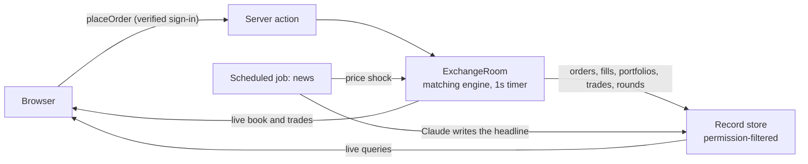

# How it works

## Fairness: frequent batch auctions

A normal exchange processes orders one by one, so whoever's packet arrives first wins. tickfair collects every order for **1 second**, then clears them together:

1. **One price per batch.** The engine picks the single price that trades the most shares. Ties are broken by the smallest imbalance, then by the price closest to the last price.
2. **Everyone trades at that price.** If you bid more than the clearing price, you pay the clearing price, and the reserved difference comes back to you.
3. **Ties are split fairly.** When there aren't enough shares to go around at the clearing price:
   - orders from earlier batches fill first;
   - orders within the same batch are split in proportion to their size;
   - any leftover single share goes to the lowest `sha256(seed + orderId)`. The seed is published on every trade.

So clicking 50 ms earlier gives no advantage. The evaluator checked this with real browsers ([process.md](process.md)).

## Architecture

- **One room holds all the money.** `ExchangeRoom` (`src/server/exchange-room.ts`) is a custom Durable Object on the SDK's `BaseRoom`. Each batch's clearing, settlement, and bot quotes run in one synchronous SQLite transaction. After every batch it checks that no money or shares were created or destroyed and no balance went negative. If a check fails, the round halts. Why a custom room: [deepspace.md](deepspace.md#main-tradeoff).
- **Results are copied into the record store**, so permissions, live sync, and reconnects are the platform's job. Your open orders and fills are visible only to you. Portfolios and trades are public, so the leaderboard is portfolios × live prices.
- **Rounds:** 15 minutes of trading, then a 2-minute results screen. Then everyone resets to $100,000.

## Bots and sim players

All of them go through the same order intake and rules as players (`src/engine/market/`).

- **Market maker, depth, and noise bots** keep the book liquid. They are left off the leaderboard.
- **Four sim players** (Momentum Max, Reversion Rita, Dip Buyer Dan, Casual Cal) trade on public prices only, so the market looks active even with one human. They show on the leaderboard with a BOT tag and never count in the standings.

## News

A scheduled job (`src/cron.ts`, `src/server/news/`) picks the stock, direction, and size of each price move. Claude only writes the headline. The headline is published before the price starts moving, and if the AI reply fails validation, there is no price move.
