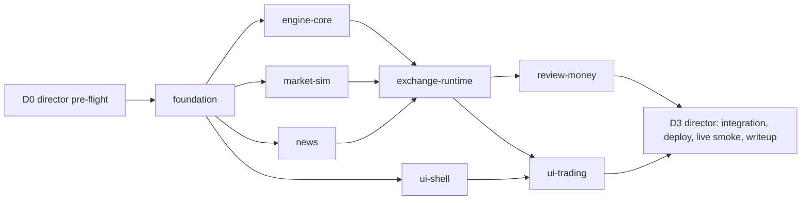

# Orchestration: Simulated HFT Exchange

This folder splits `PLAN.md` into tasks for workers. Every worker reads `BRIEF.md` first, then its own task file. The director (the main session) owns the plan, the shared files, reviews, and merges.

Status: **planned, not started.** Nothing runs until the user says go.

## Topology

- Repo root: `C:/DeepSpace-project`. `main` holds only the plan and orchestration docs until the first merge.
- Integration branch: `agent/exchange`, in worktree `C:/DeepSpace-project-exchange`. Every worker branches from here, and only the director merges into it.
- Worker worktrees: `C:/DeepSpace-project-<name>` on branch `agent/<name>`, created with `git worktree add <path> -b agent/<name> agent/exchange`.
- Each worker runs in its own herdr tab, labeled `<name>`, inside this project's workspace (`--no-focus`), with `herdr agent start <name> --kind claude`.

## Waves

| Wave | Workers (parallel within a wave) | Starts after | Approx. day |
|------|----------------------------------|--------------|-------------|
| D0 | director only | user says go | 1 |
| 0 | `foundation` | D0 | 1 |
| 1 | `engine-core`, `market-sim`, `news`, `ui-shell` | foundation merged | 1–2 |
| 2 | `exchange-runtime` + `ui-trading` (see below) | wave 1 merged | 2–3 |
| 2b | `review-money` (read-only) | exchange-runtime merged | 3 |
| D3 | director only | all merged | 4–5 |

`ui-trading` starts alongside `exchange-runtime` and builds against the frozen contracts. Before it finishes, it rebases onto `agent/exchange` once `exchange-runtime` is merged and verifies against the real engine. The director tells it when to rebase.

## File ownership (exclusive within a wave)

| Path | Owner |
|------|-------|
| `worker.ts`, `wrangler.toml`, `package.json`, lockfile, `src/schemas.ts`, `src/schemas/**`, `src/shared/contracts.ts`, `src/constants.ts`, `src/actions/index.ts`, `src/server/realtime-routes.ts` | foundation, then **director only** |
| `src/engine/core/**` (incl. `*.test.ts`) | engine-core |
| `src/engine/market/**` (incl. `*.test.ts`) | market-sim |
| `src/cron.ts`, `src/integrations.ts`, `src/actions/news.ts`, `src/server/news/**` | news |
| `tests/api.spec.ts` | news (wave 1), then exchange-runtime (wave 2) |
| `src/server/exchange-room.ts`, `src/server/exchange/**`, `src/actions/orders.ts` | foundation creates the room shell; exchange-runtime owns it from wave 2 |
| `src/pages/index.tsx`, `src/pages/(app)/_layout.tsx`, `src/pages/(app)/rounds.tsx`, `src/components/shell/**`, `src/components/feed/**`, `src/theme/**`, `docs/design/**` | ui-shell |
| `tests/smoke.spec.ts` | ui-shell (wave 1), then ui-trading (wave 2) |
| `src/pages/(app)/(protected)/trade.tsx`, `src/components/trading/**`, `src/hooks/useExchangeStream.ts`, `tests/collab.spec.ts` | ui-trading |

If a worker needs a change in a file it doesn't own, including any new dependency, it **stops and asks the director**. It never edits that file. The director adds `src/actions/index.ts` registrations at merge time.

## Ports (pin with `DEEPSPACE_PORT` in each worktree)

| Worker | Port |
|--------|------|
| primary checkout | 5173 |
| integration (`exchange`) | 5180 |
| foundation | 5181 |
| engine-core | 5182 (Vitest only; no dev server needed) |
| market-sim | 5183 (Vitest only) |
| news | 5184 |
| ui-shell | 5185 |
| exchange-runtime | 5186 |
| ui-trading | 5187 |

Always pass the same port to `dev start` and `test run`, for example `npx deepspace test run --port 5186`.

No schema migrations are involved. Collections are created from `src/schemas/**`, and only foundation and the director touch those files.

## Director steps (not delegated)

**D0: pre-flight**
1. `npx deepspace auth whoami --json` must show the user's account. If it doesn't, stop and ask the user to log in.
2. `git init` in `C:/DeepSpace-project`, then commit `PLAN.md`, `PROMPTS.md`, `project-guidlines.md`, and `orchestrations/` to `main`.
3. Create the integration branch and worktree.
4. Confirm `HERDR_ENV=1` and find the workspace id.
5. Ask the user for the GitHub repo URL and add it as `origin`. This must happen before any deploy, so the app's source latches to GitHub. Never run `deepspace push`.

**Between waves**
- Read every diff yourself. Rerun typecheck, lint, `test run unit`, `test run`, and build on the worker branch, then again on `agent/exchange` after merging.
- Update `PROMPTS.md` with any prompt the user gives.
- Record lessons in `orchestrations/files/LESSONS.md` and add them to later briefs.
- Report usage-meter pressure to the user while several workers are running.

**D3: integration and ship**
1. Two-account collab run.
2. First deploy, only with the user's go-ahead.
3. Live smoke on `<name>.app.space` with two fresh test accounts: trade, a news event, and a round rollover, with screenshots.
4. Design pass and fixes.
5. README submission note (PLAN §14). Fill the "what I verified" column of `PROMPTS.md` with the user.

## Task files

| File | Worker |
|------|--------|
| `BRIEF.md` | everyone (shared rules + contracts) |
| `00-foundation.md` | foundation |
| `01-engine-core.md` | engine-core |
| `02-market-sim.md` | market-sim |
| `03-news.md` | news |
| `04-ui-shell.md` | ui-shell |
| `05-exchange-runtime.md` | exchange-runtime |
| `06-ui-trading.md` | ui-trading |
| `07-review-money.md` | review-money |
